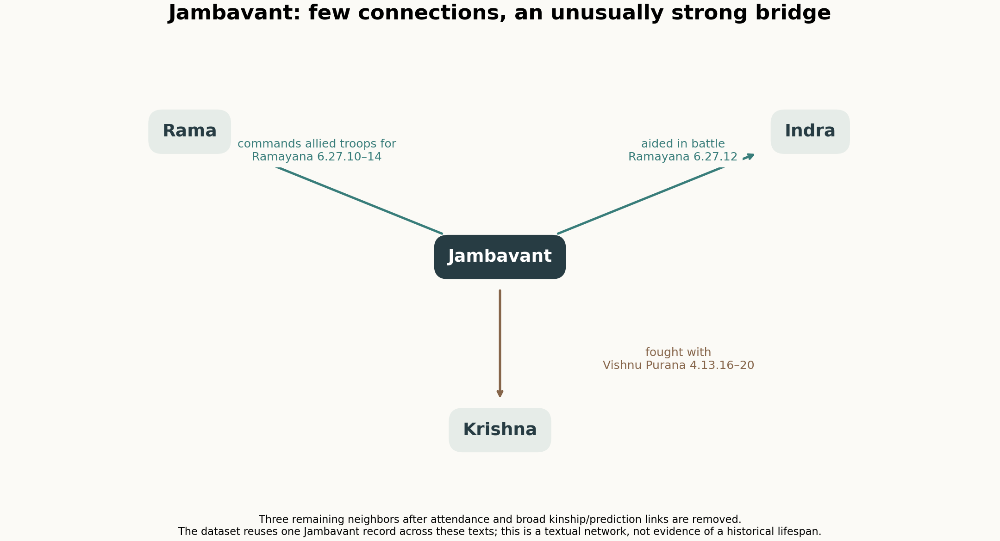
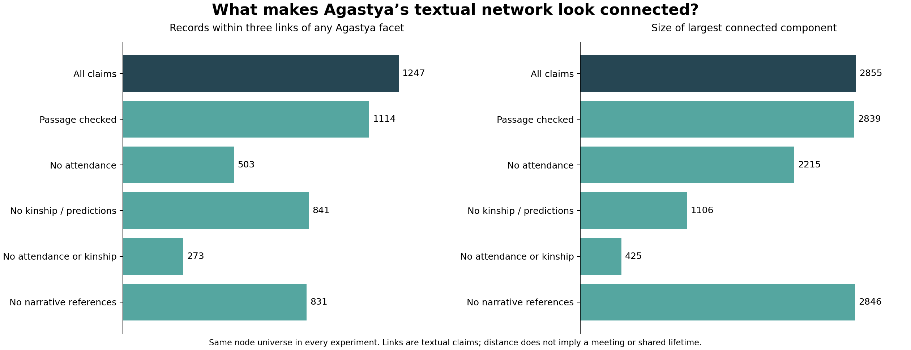

# What the graph experiments reveal

Analysis snapshot: 14 November 2026. This report describes the preserved [input-graph.json](input-graph.json): 3,295 records and 4,199 claims, before the Jāmbavant extension. The person-like projection has 3,229 records, 3,957 eligible claims, and 3,730 distinct undirected edges. Six Agastya facets are the source-local starting points. See [methods](README.md), [computed results](RESULTS.md), and [full evidence](results.json).

These are exploratory findings about a curated textual dataset. They are not new historical discoveries, proof of narrated events, or statistically significant motifs. Missing passages and source-local identity decisions strongly affect the results.

## 1. One question creates 401 apparent near-neighbors

Removing **C030 alone** moves **401 records** outside the three-link neighborhood of all Agastya facets. None of those records becomes completely unreachable: longer routes remain. This is a shortest-path effect, not a loss of 401 independent testimonies.

C030 records **Yudhiṣṭhira asking about Agastya**, not meeting him. In the [Mahābhārata, Vana Parva, Ganguli §96](https://sacred-texts.com/book/the-mahabharata-book-3-vana-parva/section-xcvi), he addresses Lomaśa, who tells the Agastya story. The graph connects this reference to Yudhiṣṭhira’s much larger neighborhood of attendees, relatives, and other relationships.

This is the strongest result for explaining why edge semantics matter. A story about someone can create the same two-endpoint shortcut as an encounter if the analysis ignores predicates. A computationally short path can cross several levels of narrative framing.

**Possible post:** “I removed one ‘asks about’ relationship from an ancient-text graph. 401 records moved beyond three links from Agastya. They weren’t 401 lost acquaintances: a question to a storyteller had been acting as a shortcut.”

## 2. Jāmbavant is a small-degree bridge that survives removing rosters

With attendance edges removed, **Jāmbavant ranks third by exact betweenness**, with just **six neighbors**. When broad kinship and prediction relationships are also removed, he ranks **fifth**, with **three neighbors**:

| Neighbor | Recorded relationship | Evidence |
|---|---|---|
| Rāma | Commands allied troops for | RMW_017; [Rāmāyaṇa 6.27.10–14](https://sanskritdocuments.org/sites/valmikiramayan/yuddha/sarga27/yuddharoman27.htm) |
| Indra | Aided in an earlier battle | RMW_030; [Rāmāyaṇa 6.27.12](https://sanskritdocuments.org/sites/valmikiramayan/yuddha/sarga27/yuddharoman27.htm) |
| Kṛṣṇa | Fought with | GYM279; [Viṣṇu Purāṇa 4.13.16–20](https://press-files.anu.edu.au/downloads/press/n8264/html/book04.xhtml?page=9&referer=) |

The cited Rāmāyaṇa passage describes his help to Indra, while the Viṣṇu Purāṇa passage narrates his twenty-one-day fight with Kṛṣṇa. The graph makes him a junction between these narrative neighborhoods.

This is a more substantive candidate than a hub produced by hundreds of assembly attendees. It is also **conditional on the dataset reusing one Jāmbavant record across texts**. The algorithm has not independently established that identification, contemporaneity, or a historical lifespan. The diagram shows the three retained neighbors, not his complete six-neighbor ego network.

**Possible post:** “After removing assembly lists and family links from my graph, Jambavant still stands out as a bridge—with only three neighbors: Rama, Indra, and Krishna. The interesting part is the different relationships and passages behind each edge.”

## 3. Four-parent records lead to a rebirth narrative

The explicit parent-edge scan finds **12 records with at least three parent records**. Three especially useful cases are **Pāvaka, Pavamāna, and Śuci**, each connected to four parents:

- Agni and Svāhā, through **SB4_0187–SB4_0192**, [Bhāgavata 4.1.60](https://vedabase.io/en/library/sb/4/1/60/).
- Vijitāśva / Antardhāna and Śikhaṇḍinī, through **SB4_0354–SB4_0359**, [Bhāgavata 4.24.3–4](https://vedabase.io/en/library/sb/4/24/3/).

The immediately following explanation says that the three were formerly fire deities and became Antardhāna’s sons because of Vasiṣṭha’s curse. This is explicit in the cited translation of [4.24.4](https://vedabase.io/en/library/sb/4/24/4/).

The graph anomaly is therefore a prompt to inspect narrative identity across births. A model with one character node and undifferentiated parent edges flattens distinct life episodes. A future representation could attach parentage to **source-specific birth episodes**, linked through an explicitly narrated rebirth relationship. That is a modeling proposal, not a change made in this run.

**Possible post:** “My genealogy query found three characters with four parents each. Reading the passages explained why: a rebirth story. Sometimes an apparent data anomaly means the model needs a richer idea of identity.”

Other multiple-parent cases have different explanations: duplicated source-local records, alternative divine names, role language, or incorrect extraction. Do not generalize the rebirth explanation to all 12.

## 4. One identity assertion changes who looks like a bridge

The Nahuṣa record has only **two neighbors** but baseline betweenness of **0.0987**. One of its connections, **RFX008**, links the epic curse dossier to a separate Nahuṣa genealogy record using Sörensen’s secondary name index. It is explicitly marked `scholarly_report` and `category: identity`.

Removing that one secondary identity edge leaves the same **2,855-record largest component**, but changes the ranking substantially. **Tapatī and Saṃvaraṇa become fourth and fifth** by betweenness in that variant; neither appears in the baseline top eight. Eight records leave the three-link root neighborhood, while no record becomes unreachable.

This is a good example of **route redundancy with ranking fragility**: a network can stay connected while the interpretation of its most important bridges changes. It also shows why cross-text identity links should be a separate analytical layer. This result does not invalidate the Nahuṣa identification; it measures its structural influence.

## 5. Much of the apparent proximity comes from rosters

| Relationships retained | Records within three links of any Agastya facet |
|---|---:|
| Baseline | 1,247 |
| Passage-checked claims only | 1,114 |
| Without attendance | 503 |
| Without narration/reference | 831 |
| Without broad kinship/predictions | 841 |
| Without attendance or broad kinship/predictions | 273 |

Attendance removal reduces the three-link neighborhood by **744 records, or 59.7%**. Removing attendance and broad kinship/predictions reduces it by **974 records, or 78.1%**. These effects overlap and must not be added together. The fixed universe includes deities and collectives; these are not counts of historical human acquaintances.

The baseline has **125 connected components**, **74 isolates**, and a **2,855-record largest component**. Raw Louvain finds **88 communities among active records**, with modularity approximately **0.904**. The largest clusters reflect combinations of source coverage, rosters, and genealogy. High modularity here does not independently demonstrate historical social groups: the graph is sparse, incomplete, and already fragmented.

Across seeds 7, 19, 42, baseline community agreement has adjusted Rand scores approximately **0.895–0.924**. The structure is reasonably consistent across these seeds, but that is not evidence of robustness to missing sources or different identity decisions.

## 6. Source overlap is concentrated, and identity choices hide some overlap

The endpoint-pair search finds **46 pairs spanning at least two source families**. The most broadly recurring pair is **Daśaratha–Rāma**, represented by father/son claims in the Rāmāyaṇa, Mahābhārata, and Viṣṇu Purāṇa (**EEX003, VSG040, MB2EARLY_202**). The normalized typed-relation output distinguishes inverse father/son wording from different predicates.

Many recurring pairs concern divine genealogies shared by the Mahābhārata and Bhāgavata. That is an observation about the presently linked records, not a corpus-wide rate of textual agreement. Some names remain separate across sources, so equivalent pairs can remain invisible to this query. Recurrence across works does not establish independent historical corroboration.

Removing the single **electronic Ādiparvan source record** makes **619 records** unreachable from the root set. That source spans much more text than a source record for a single hymn. The result reveals coverage dependence; it does not rank the importance of whole traditions.

## 7. Motifs are useful for detecting semantic errors

The strict scans find **198 parent–spouse triangles**, **eight two-edge teaching chains**, and **no directed parent cycles** within the explicit predicate sets. No killing-within-two-family-steps motifs are found under the strict parent/spouse projection and recorded identities. These are descriptive counts, not enrichment tests or evidence of absence in the literature.

Passage inspection caught **MBAPE128**: the baseline predicate is `is_father_of` from Droṇa to Dhṛṣṭadyumna, but both summary and note expressly deny parentage and describe teaching. This claim is **excluded from baseline typed motifs** and remains visible in the preserved raw baseline. The canonical expansion/review pipeline now corrects it to `teacher_of`.

Two more traps were excluded from accepted teaching chains:

- **MBAL058:** Bhīṣma *appoints* Droṇa as teacher; this does not make Bhīṣma Droṇa’s teacher.
- **MBAL065:** Ekalavya *requests* instruction and is refused; that request alone does not establish an accepted teacher–student relationship.

The three alternative reported teachers of Tamil Agastya—Avalokiteśvara, Śiva, Skanda—produce separate qualified paths to Tolkāppiyar. They are alternative traditional claims, not one simultaneously asserted school lineage. Original-language review of the relevant commentary traditions remains pending.

## 8. Blind name matching can nearly double apparent proximity

An intentionally unsafe merge of exact labels before ` · ` collapses **854 records**. Projecting the result back onto the original records:

- **1,669 previously reachable records** acquire shorter paths.
- **277 previously unreachable records** become reachable.
- The three-link neighborhood grows from **1,247 to 2,387 original non-root records**.

This is not a proposed identity resolution. The merge ignores branch distinctions and homonyms and does not even reconcile spelling variants. It is a stress test demonstrating how much apparent “discovery” an aggressive normalization rule can manufacture.

As a control, merging only the six Agastya facets does **not** change minimum distances from the existing multi-source root set. That is expected mathematically, since all six already start at distance zero. It says nothing about whether they represent one historical individual; other pairwise distances and centralities can still change.

## Best topics to develop publicly

1. **Rebirth and four parents:** strongest narrative opening, with a clear connection to data modeling and directly checked passages.
2. **Jāmbavant as a bridge:** visually simple, with distinct source-qualified edges that survive removing attendance and kinship.
3. **The 401-record question:** strongest compact numerical illustration of how one narrative reference changes graph distance.

Each is a finding from a computational reading of the dataset, not a claim that the underlying literary material is newly discovered. No social post has been published as part of this analysis.
