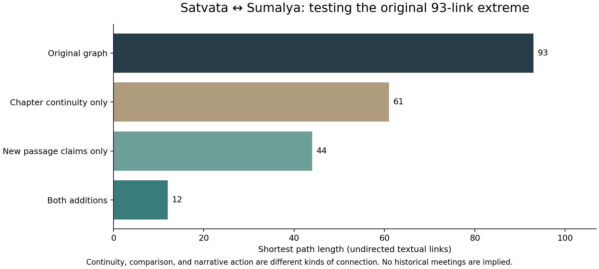

# Looking for the graph’s least-connected records

The starting graph at commit `25c0987` has **125 person-like connected components**. Disconnected pairs have no finite distance, so there is no unique “least related pair.” Among pairs with a path, the unique maximum is **Satvata (VP 4.12) ↔ Sumālya (VP 4.24), 93 links apart**.

The experiment computes exact distances from every vertex in every component, rather than using a sampled diameter estimate. Its before/after controls separate passage additions from editorial chapter-continuity links. See [numerical results and full paths](README.md), [machine-readable evidence](results.json), and the [eight-claim expansion batch](../agastya/expansion/distance_bridges.json).

## The most useful connection

**Candragupta ← Kauṭilya → Mahāpadma Nanda → Paraśurāma** is now a three-link path; its endpoints were previously disconnected.

The middle connection concerns dynastic overthrow; the final one is a comparison. The [Wilson translation of VP 4.24](https://sacred-texts.com/book/the-vishnu-purana/chapter-xxiv) supports both. The Candragupta appointment already existed as GFD018. Adding FD002–FD005 recovered a bridge between a royal succession account and an epic figure without inventing a meeting.

Rāma and Aśokavardhana likewise change from disconnected to **seven links apart**. Their shortest path includes assembly attendance, the Nanda comparison, and dynastic relationships. Removing attendance makes it nine links; removing just the Nanda comparison makes it 55. The connection’s meaning depends on its verbs.

## A chapter boundary manufactured distance

The [ANU translation](https://press-files.anu.edu.au/downloads/press/n8264/html/book04.xhtml?page=9&referer=) continues Satvata’s family from chapter 12 into chapter 13. Our graph had two distant dossiers. FD001 records editorial continuity while retaining both nodes.

| Additions | Original Satvata–Sumālya pair |
|---|---:|
| None | 93 links |
| Chapter continuity only | 61 |
| Passage claims only | 44 |
| Both | 12 |

The 12-link route still passes through an accusation, attendance, and a simile. It is a textual path, not a reconstructed social network. With attendance removed, it becomes 14 links.

## A disconnected genealogy can be reattached

A separate 31-record Bṛhadbala branch is linked back through a chapter-continuity claim and the battle relationship in VP 4.4.60. Sumitra, the terminal record in that branch, changes from disconnected from the VP Abhimanyu dossier to **32 links away**. The long remaining route is almost entirely a source-attributed projected genealogy. No unrelated Bṛhadbala namesakes are merged.

The Maurya-to-Śuṅga transition adds another bridge, carefully distinguishing the final Maurya from earlier homonymous kings. All eight new claims are in the canonical graph, with editorial identity claims separately marked.

## Diameter alone is a poor progress measure

Adding only chapter-continuity links increases the global maximum from **93 to 114** because a long previously separate branch joins the main component. With all additions, the maximum is **88** and there are **122 components**. The new extreme is **Pulomāvi ↔ Trayyāruṇa**.

That 88-link pair is a next research candidate, not a solved historical relationship. We stopped after checking the selected source-backed bridges, rather than continually adding convenient edges until every distance became short. Most remaining disconnected records need further passage review.

