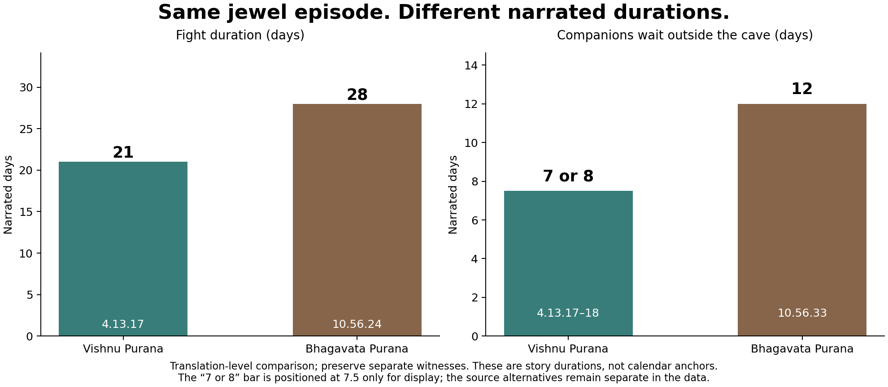

# Jāmbavant: targeted textual dossier

Research snapshot: 15 November 2026. **37 passage-level claims, eight observations, 19 source records.** These are integrated into the canonical Agastya graph through `expansion/jambavant_deep_dive.json`; the original source-local dossiers and explicit literary alignment maps remain in `records.json`. Translation-level review only; no critical-edition concordance or systematic Sanskrit audit is claimed.

The [narrative follow-up](NARRATIVE.md) audits the actual MWIS paths and examines the contrast between Jāmbavant's initial misrecognition of Kṛṣṇa and his later recognition through earlier divine deeds.

## What stands out

### Herb collection recurs in two very different episodes

In **JV025–JV026**, [Rāmāyaṇa 4.66.33](https://www.valmikiramayan.net/utf8/kish/sarga66/kishkindhasans66.htm), Jāmbavān recalls collecting herbs for divine nectar-churning. His later instruction to Hanumān concerns four battlefield remedies in **JV009**, 6.74.26–34. The recurring herb motif is worth investigating; the passages do not explicitly say that the first episode caused his knowledge in the second, or that the plants are identical.

### The two jewel tellings differ in ritual action as well as duration

In **JV029–JV031**, [Viṣṇu Purāṇa 4.13.18–19](https://press-files.anu.edu.au/downloads/press/n8264/html/book04.xhtml?page=9&referer=), funeral offerings made for the presumed-dead Kṛṣṇa sustain him during the duel while Jāmbavant has no food. In **JV036**, [Bhāgavata 10.56.35](https://vedabase.io/en/library/sb/10/56/35/), the residents pray for Kṛṣṇa’s return to **Candrabhāgā / Durgā**. These selected passages present different ritual actions. No claim about their historical efficacy or universal absence from other witnesses is made.

### He can restrain a proposal, as well as encourage action

In **JV027–JV028**, [Rāmāyaṇa 5.60.1–6](https://www.valmikiramayan.net/utf8/sundara/sarga60/sundarasans60.htm), Aṅgada proposes bringing Sītā back themselves. Jāmbavān asks him to consider Rāma’s intention. Expanded retellings can turn this into an explicit prohibition on unauthorized rescue; this short source passage is more restrained. The graph encodes counsel and a proposal, not an accomplished rescue or a formal command.

### The connection to Rāma is voiced inside the Kṛṣṇa story

In [Bhāgavata 10.56.26](https://vedabase.io/en/library/sb/10/56/26/), Jāmbavān identifies Kṛṣṇa as Viṣṇu. In [10.56.28](https://vedabase.io/en/library/sb/10/56/28/), his address invokes the bridge, Laṅkā, and the fall of Rāvaṇa. This gives a **literary basis** for continuity across the Rāma and Kṛṣṇa narrative worlds, beyond matching a name.

Claim **JV014** records what he attributes to his addressee. The verse does not explicitly name Rāma, nor assert that Jāmbavān personally witnessed every recalled deed. It is not a historical identity or lifespan claim.

### He repeatedly enables another hero’s action

In [Rāmāyaṇa 4.65.20–35](https://www.valmikiramayan.net/utf8/kish/sarga65/kishkindhasans65.htm), he argues against risking Aṅgada as leader, then turns to Hanumān. In [4.66](https://www.valmikiramayan.net/utf8/kish/sarga66/kishkindhasans66.htm), he uses knowledge of Hanumān’s origins and abilities to encourage him. **JV003–JV006** capture these roles without assigning formal teacher status.

During the later battlefield crisis he prioritizes Hanumān’s survival and sends him for healing herbs: **JV008–JV009**, [6.74.18–34](https://sanskritdocuments.org/sites/valmikiramayan/yuddha/sarga74/yuddharoman74.htm). A useful interpretation is **recognition and delegation as forms of agency**. That is a reading of these selected scenes, not a statistically established character trait.

The graph’s old commander/fighter/father description missed this role because it lacked these passages. Raw centrality measures reachability; a typed narrative reading asks how someone makes action possible.

### The Vāmana connection appears in two different forms

In **JV002**, [Rāmāyaṇa 4.65.15](https://www.valmikiramayan.net/utf8/kish/sarga65/kishkindhasans65.htm), Jāmbavān recalls circumambulating Trivikrama during Bali’s sacrifice. In **JV011**, [Bhāgavata 8.21.8](https://vedabase.io/en/library/sb/8/21/8/), he proclaims Vāmana’s victory. These are different actions. A nearby passage omitted in the first pass, **JV024 / JVO08**, Rāmāyaṇa **4.66.32**, explicitly describes **21 circuits of the earth** during Trivikrama’s time. The earth and Trivikrama should not silently become the same object of circumambulation.

The corpus therefore offers routes into Vāmana/Trivikrama, Rāma, and Kṛṣṇa episodes. Their association is narrative and theological, without calendar dates inferred here.

### The jewel episode has meaningful variants

| Detail | Viṣṇu Purāṇa, linked translation | Bhāgavata, linked translation |
|---|---|---|
| Fight length | 21 days, 4.13.17 | 28 days, 10.56.24 |
| Companions wait before leaving | Seven or eight days, 4.13.17–18 | 12 days, 10.56.33 |
| Child in the cave | Translator uses Sukumāra | Unnamed young son, 10.56.15 |

Sources: [Viṣṇu Purāṇa, Book 4, chapter 13](https://press-files.anu.edu.au/downloads/press/n8264/html/book04.xhtml?page=9&referer=), [Bhāgavata fight length](https://vedabase.io/en/library/sb/10/56/24/), [waiting period](https://vedabase.io/en/library/sb/10/56/33/), [chapter 10.56](https://vedabase.io/en/library/sb/10/56/).

A third checked witness, [Harivaṃśa 1.38.39 in this site edition](https://www.dvaipayana.net/harivamsa/harivamshaparva/hv_1_38.html), also gives 21 days. Do not conflate the site’s 1.38 numbering with other editions’ chapter numbering. This supports a comparative-text table, not three independent historical accounts. Its additional observation does not add a new structural edge.

The safe model stores durations on **source-qualified episode records**, not a single global “fight length” property. The unnamed Bhāgavata child is kept separate from Sukumāra. Determining whether a child-address expression is a proper name would require philological review.



### His family reaches into a later dynastic crisis

**JV015** identifies Jāmbavatī as Jāmbavān’s daughter in [10.56.32](https://vedabase.io/en/library/sb/10/56/32/). **JV020–JV021** connect her to Sāmba in [10.61.11–12](https://vedabase.io/en/library/sb/10/61/10-12/) and [11.1.14](https://vedabase.io/en/library/sb/11/1/13-15/). The later episode features Sāmba disguised by the Yadu boys; the sages then predict a dynasty-destroying club in [11.1.16](https://vedabase.io/en/library/sb/11/1/16/).

This creates a short family path from Jāmbavān to a participant in that crisis. It does **not** make Jāmbavān its cause, or warrant treating the group’s actions as Sāmba’s alone. The path comes from combining named relationships, rather than a new explicit “grandfather” sentence.

## What the deeper graph test changes

The canonical merge script explicitly rewrites `ram6_jambavan` into `vp4_13_jambavant`. The earlier high bridge score therefore already incorporated a cross-text alignment. We tested reversing just that identity decision while leaving every other identity choice fixed.

With attendance removed:

| Scenario | Jāmbavant record | Betweenness rank | Neighbor records |
|---|---|---:|---:|
| Original graph | Combined Rāmāyaṇa / VP | 3 | 6 |
| Existing Jāmbavant split by text | VP dossier | 865 | 3 |
| Existing Jāmbavant split by text | Rāmāyaṇa dossier | 24 | 3 |
| Added passages, source-local | Rāmāyaṇa dossier | 20 | 9 |
| Added passages, Jāmbavant dossiers aligned | Combined dossier | 2 | 16 |
| Also align listed Kṛṣṇa, Jāmbavatī, Sāmba and Vāmana records | Combined dossier | 2 | 13 |

Full results: [RESULTS.md](RESULTS.md), [analysis.json](analysis.json). The fixed union of person-like records includes unused records as isolates so normalization stays comparable. “Neighbors” means graph records, not a count of distinct historical people. The 16-to-13 change demonstrates duplicate target records being consolidated. It is not a discovery of fewer actual acquaintances.

**Conclusion:** his structural prominence is conditional on textual identity alignment. The new reading provides additional narrative reasons to investigate that alignment, while the source-local alternative remains visible. Adding passages targeted at a selected figure also changes the sampling; a rank increase is not independent validation or evidence of historical importance.

## New evidence map

| Claims | Evidence type | Passages |
|---|---|---|
| JV001, JV010 | Origin / attributed parentage | Rāmāyaṇa 1.17.7; 6.74.14 |
| JV002, JV011 | Trivikrama recollection / Vāmana victory | Rāmāyaṇa 4.65.15; Bhāgavata 8.21.8 |
| JV003–JV006 | Counsel, encouragement, recollection | Rāmāyaṇa 4.65–66 |
| JV007–JV009 | Voice recognition, inquiry, mission instruction | Rāmāyaṇa 6.74 |
| JV012–JV019 | Fight, recognition, kinship, jewel episode | Bhāgavata 10.56 |
| JV020–JV023 | Family continuity / later group episode | Bhāgavata 10.61; 11.1 |
| JV024–JV028 | Earth circuits, herbs, counsel and proposed rescue | Rāmāyaṇa 4.66; 5.60 |
| JV029–JV036 | Ritual action, information flow and suspicion | VP 4.13; Bhāgavata 10.56 |
| JV037 | Initial misrecognition before later recognition | Bhāgavata 10.56.22 |
| JVO01–JVO08 | Durations, waiting alternatives, capacities and circuits | VP 4.13; Rāmāyaṇa 4.65–66; Bhāgavata 10.56; Harivaṃśa 1.38 |

The source-specific summaries, locators, speaker qualifications, and URLs are in [records.json](records.json). Jambha, Jambhāsura, Jambūmāli, and Vāmana the serpent are explicitly excluded from name matching.

## Reproduce

Use the environment in [the graph-analysis guide](../agastya/analysis/README.md), then from the repository root:

```sh
python3 build_jambavant_dossier.py
python3 analyze_jambavant.py
python3 -m unittest discover -s research/jambavant -p 'test_*.py'
```

`build_jambavant_dossier.py` recreates the manually curated source-local supplement and canonical expansion batch. Run `merge_agastya_expansion.py` and the render pipeline to integrate it. `analyze_jambavant.py` uses the preserved pre-extension `../agastya/analysis/input-graph.json` for its five comparisons, so adding the supplement does not silently change the baseline. It writes exact centrality comparisons and the duration chart.

Remaining work includes Sanskrit/edition checks, a broader concordance, and modeling narrated recognition without flattening it into identity. The Brahmā origin, the Vāmana recollection, and the Syamantaka episode do not independently establish one historical lifespan.

## Strongest post angle

The herb-collection echo and the different ritual actions in the jewel episode are stronger leads beyond the familiar longevity and Hanumān-encouragement stories. The nurse’s song and attributed accusations also support a graph of information flow: who suspects, who hears, and what the narrator says actually happened. These are computational readings of known texts, not claims to have discovered an unknown ancient story.
