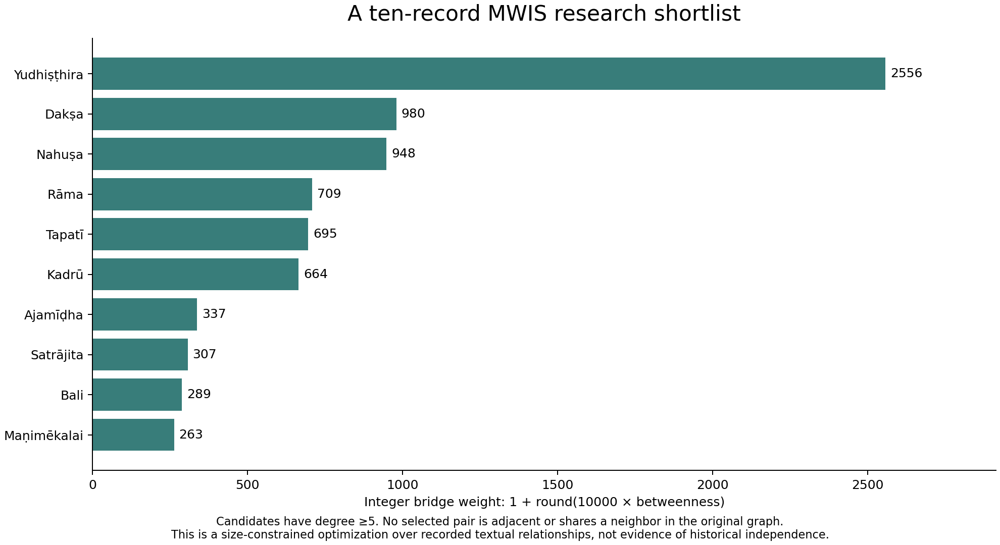

# What MWIS selects from this graph

Seven models were solved with SciPy/HiGHS. **Every solution has solver status optimal and zero reported MIP gap**, for its stated integer weights and constraints. The input is the graph at commit `bc7f074`: 3,238 person-like records and 3,752 undirected edges, including 74 isolates.

## Ordinary MWIS mostly collects peripheral records

| Weights | Selected records |
|---|---:|
| Uniform, equivalent to maximum cardinality | 2,455 |
| 1 + degree | 2,433 |
| 1 + passage-checked source-family count | 2,455 |
| 1 + rounded, scaled betweenness | 1,591 |

The uniform solution contains **1,820 records of degree at most one**, about 74% of its selection. There are **56,011 selected pairs sharing a neighbor**, despite no selected pair having a direct edge. Yudhiṣṭhira alone has **171 selected neighbors**.

This is the expected optimization behavior on stars and sparse lineage trees. It does not identify unrelated characters: many assembly members or siblings can be selected together precisely because their host or parent is not selected, and the graph does not encode every pairwise association.

The bridge-weighted ordinary MWIS does retain high-scoring records such as Yudhiṣṭhira, Indra, Dakṣa, epic Nahuṣa, Yama, Draupadī and Kṛṣṇa. However, its 1,591-record result is still too large to function as a concise research agenda.

## A more useful exploratory shortlist

For a bounded research shortlist we used:

1. All **193 records with original degree ≥5** as candidates.
2. Weight `1 + round(10000 × original exact betweenness)`.
3. Conflicts between candidates at original-graph distance one **or two**.
4. A maximum of **ten** selected records.

This is explicitly a **cardinality-constrained MWIS on a stronger conflict graph**, not the ordinary MWIS of the original graph.

| Selected dossier | Weight |
|---|---:|
| Yudhiṣṭhira | 2,556 |
| Dakṣa · Prajāpati witness | 980 |
| Nahuṣa · Viṣṇu Purāṇa witness | 948 |
| Rāma | 709 |
| Tapatī | 695 |
| Kadrū | 664 |
| Ajamīḍha · Hastin branch | 337 |
| Satrājita | 307 |
| Bali · Daitya witness | 289 |
| Maṇimēkalai · Tamil epic heroine | 263 |

The objective is **7,748**, with no direct selected–selected links and no shared original-graph neighbors. These are useful structurally separated starting points for further reading; they are not ten independent traditions or ten historically unrelated people.

The unbounded version of the same stronger conflict model selects **54** candidates. Of those, 49 are mandatory under its exact objective and five are optional across tied optima. By contrast, forbidding each member of the capped ten-record set and re-solving lowers the certified optimum in every case: all ten are mandatory for this exact capped model. That establishes conditional optimizer stability, not robustness to missing passages, weights, or identity decisions.

## Why Jāmbavant does not appear in that ten

Forcing Jāmbavant into the shortlist gives an optimum of **7,691**, just **57 points or 0.74% below** the unconstrained-by-membership optimum. He conflicts with Rāma, Satrājita and Bali in the stronger conflict graph. The best forced solution can substitute other records; it does not simply drop those three without replacement.

The forced optimum keeps the other seven original members and replaces Rāma, Satrājita and Bali with **Jāmbavant, Dharma (the Ādiparvan deity dossier), and Sātvata (the Viṣṇu Purāṇa dossier)**. This gives us a concrete alternative set to investigate, rather than interpreting one optimal selection as the only useful agenda.

The [passage-level narrative audit](../jambavant/NARRATIVE.md) distinguishes these conflicts: Rāma is directly linked; Satrājita shares Kṛṣṇa as a neighbor; Bali shares Indra. The last path does not establish a meeting or a shared battle between Bali and Jāmbavant.

This is a useful near-optimal alternative if Jāmbavant is a research priority. His omission is not evidence of unimportance. Indra, Arjuna and Kṛṣṇa have larger forced-in costs—670, 662 and 662 points respectively—because choosing them blocks combinations the objective prefers. All forced-in alternatives were also solved to optimality.

## What this experiment adds

The most useful role for MWIS here is selecting starting points that are structurally less redundant under an explicit model. It does not discover new relationships or validate historical independence. Source-local duplicates, incomplete coverage, and the meaning of edges remain important. Betweenness-based weights inherit the assumptions of the graph they are computed from.

See [methods, complete hub selections and forced-in results](README.md), [all memberships and scores](memberships.csv), and [solver certificates and selected IDs](results.json). No new textual claims were added to the canonical graph by this experiment.
